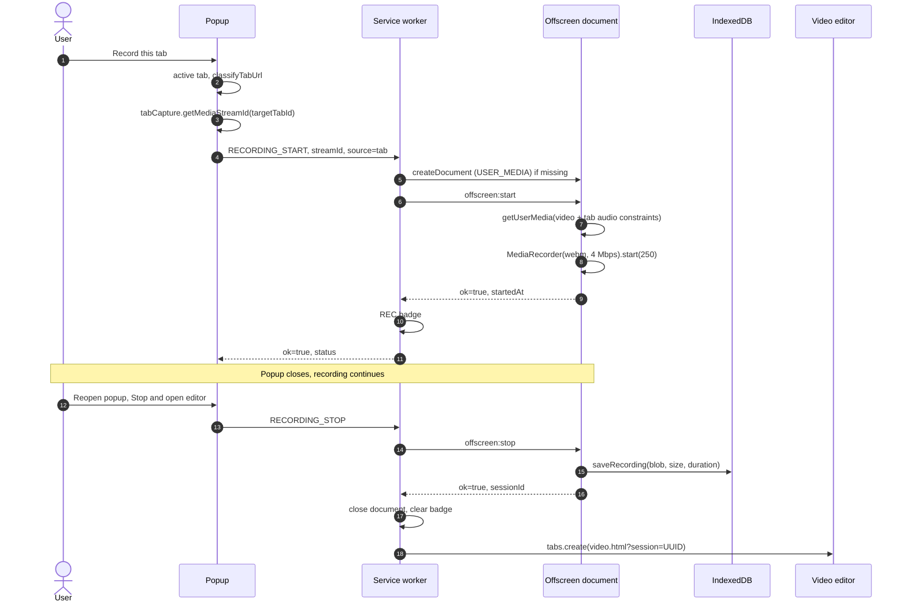
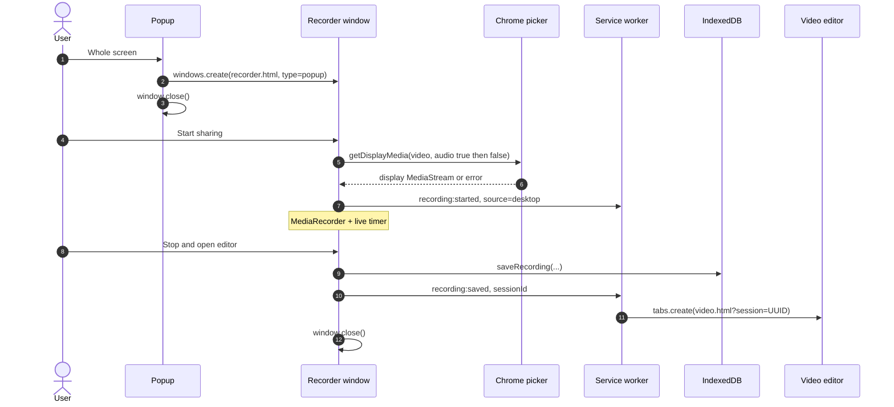
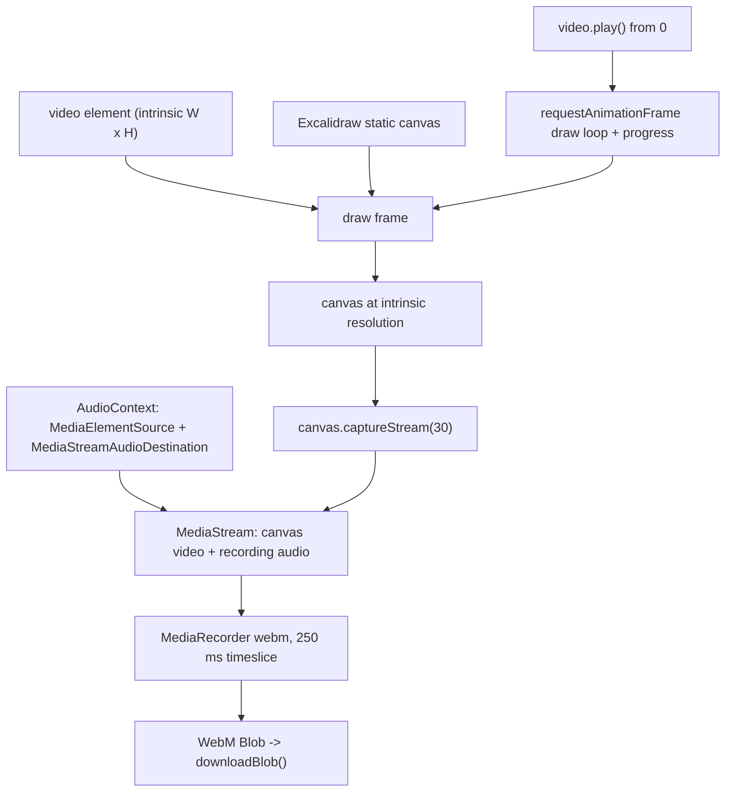
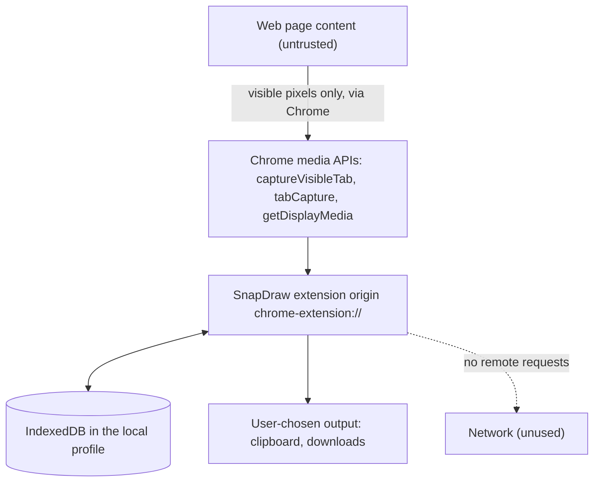

# SnapDraw Architecture

SnapDraw is a local-only Chrome Manifest V3 extension that captures the visible viewport, annotates it
in an embedded Excalidraw canvas, and records tab or whole-screen video with the same annotation layer.
There is no backend, analytics, CDN or remote asset: every byte stays in the browser profile.

Working rules and commands live in [AGENTS.md](AGENTS.md); user documentation is [README.md](README.md).

## 1. Overview

MV3 constraints drive the design:

- A service worker has no DOM, so it cannot own a `MediaRecorder`, a `<video>` or a canvas.
- The popup is destroyed on blur, so recordings cannot live there.
- Chrome answers the `getDisplayMedia()` picker only from a **visible** extension page.
- `chrome.tabs.captureVisibleTab()` needs the `activeTab` grant from a user invocation.
- Extension pages share one origin, so the popup, worker and editors exchange blobs through IndexedDB
  instead of message plumbing.

Excalidraw (`@excalidraw/excalidraw@0.18.1`) is embedded as a React component; SnapDraw configures the
scene, theme, asset path and main menu rather than forking it.

| Surface | Entry | Lifecycle |
| --- | --- | --- |
| Toolbar popup | `src/popup/popup.html` | Closes on focus loss |
| Background service worker | `src/background/service-worker.ts` | Ephemeral; may stop between events |
| Screenshot editor tab | `src/editor/editor.html` | Long-lived, `?session=<uuid>` |
| Video editor tab | `src/video/video.html` | Long-lived, `?session=<uuid>` |
| Offscreen recorder | `src/offscreen/offscreen.html` | Hidden, no UI |
| Screen recorder window | `src/recorder/recorder.html` | Visible popup-type window, self-closes |

## 2. Component map

| File | Responsibility |
| --- | --- |
| `public/manifest.json` | Popup, module worker, `capture-screenshot` command, exact four permissions, strict CSP, stable `key`. |
| `public/excalidraw-asset-path.js` | Classic script before the module bundle: local `EXCALIDRAW_ASSET_PATH` + CDN font-fallback rewrite. |
| `vite.config.ts` / `vitest.config.ts` | Multi-entry MV3 build; node-env test config that avoids Vite's Windows config probe via `createRequire`. |
| `src/types/index.ts` | Single source of truth for messages, recording state, capture responses, errors and the stored record shape. |
| `src/utils/messaging.ts` | Page paths, `session`/`error` query params, `SnapDrawError`, URL builders, typed message wrappers. |
| `src/utils/image-conversion.ts` | Data URL ↔ Blob, dimensions, `fitWithin`, byte formatting, `wrapImageDataUrlInSvgDataUrl`. |
| `src/utils/canvas-readback.ts` | Narrow `getImageData` shim for Excalidraw's eyedropper (editor/video pages). |
| `src/background/service-worker.ts` | Capture messages/command, recording orchestration (offscreen + badge + stop/status), lifecycle pruning, toolbar error feedback. |
| `src/services/screenshot.service.ts` | Capture pipeline: active tab, restricted-page classification, `captureVisibleTab`, size guard, store, editor tab, purge. |
| `src/services/storage.service.ts` | IndexedDB open/upgrade, CRUD, history listing, trim, TTL purge. |
| `src/services/thumbnail.service.ts` | ≤320 px thumbnails at capture time and on-demand backfill for legacy rows. |
| `src/services/image.service.ts` | Load/decode a stored capture into the data URL + dimensions the editor needs. |
| `src/services/export.service.ts` | `exportToBlob` wrapper (1:1, white background, padding), size guard, filenames, `downloadBlob`. |
| `src/services/clipboard.service.ts` | Async Clipboard PNG writes with typed failure modes. |
| `src/services/recording.service.ts` | `tabCapture` stream-id handover, recording names, save recording as a history row. |
| `src/services/video.service.ts` | WebM mime preference, video record detection, duration/filename formatting, video thumbnails. |
| `src/services/video-export.service.ts` | Frame compositing, PNG still, real-time annotated WebM export (canvas stream + audio graph). |
| `src/popup/Popup.tsx`, `useCapture.ts`, `useRecentScreenshots.ts`, `openScreenshot.ts`, `shortcut.ts` | Capture action, split record controls, live timer, recent/history UI, capture state machine, editor routing. |
| `src/editor/Editor.tsx` | URL parsing, load/error screens, custom `MainMenu`, clear annotations, scene mirror, `?` help suppression. |
| `src/editor/EditorCanvas.tsx` | Initial scene (one locked image + binary file), `UIOptions`, one-time fit to content. |
| `src/editor/EditorHeader.tsx` | Undo/redo, reset view, lock toggle, Copy Image, Download. |
| `src/editor/excalidrawActions.ts` | Synthetic Ctrl/Cmd+Z dispatch, scene reads, fit-to-content. |
| `src/editor/editor.css` | Shell/header CSS, hidden Excalidraw help/library, `filter: none` dark-canvas parity. |
| `src/editor/AboutDialog.tsx`, `links.ts`, `useColorScheme.ts` | Local About dialog, the only outbound links, live OS theme. |
| `src/video/VideoEditor.tsx` | Loads the recording, object URL, transport, copy frame, export progress/cancel, download original. |
| `src/video/VideoStage.tsx` | `<video>` (`object-fit: contain`) + transparent Excalidraw overlay exactly over the video rect. |
| `src/video/VideoHeader.tsx`, `TransportBar.tsx` | Export/more menu and custom playback controls. |
| `src/offscreen/offscreen.ts` | Owns `getUserMedia` + `MediaRecorder`, status, finalisation and `saveRecording` for "This tab". |
| `src/recorder/recorder.ts` | `getDisplayMedia`, picker handling, `MediaRecorder`, timer, save/discard and worker notifications. |
| `scripts/copy-fonts.mjs`, `validate-build.mjs`, `e2e.mjs` | Font copy, dist validation, headless CDP E2E harness. |
| `tests/*.test.ts` | Vitest suites (storage, helpers, messaging, manifest, services, readback shim). |
| `.sandbox/*` | Gitignored local debug + headed-Chrome verification scripts; not shipped. |

## 3. End-to-end flows

### 3.1 Screenshot capture

```mermaid
sequenceDiagram
  autonumber
  actor U as User
  participant P as Popup
  participant SW as Service worker
  participant C as Chrome capture API
  participant DB as IndexedDB
  participant E as Editor tab

  U->>P: Capture (button or Ctrl/Cmd+Shift+S)
  P->>SW: CAPTURE_SCREENSHOT, source=popup
  SW->>SW: active tab, classifyTabUrl
  alt restricted page
    SW-->>P: ok=false, RESTRICTED_PAGE
  else http or https page
    SW->>C: captureVisibleTab(windowId, png)
    C-->>SW: data:image/png;base64,...
    SW->>SW: blob, dimensions, size guard, thumbnail
    SW->>DB: putScreenshot(record)
    SW->>E: tabs.create(editor.html?session=UUID)
    SW-->>P: ok=true, sessionId, size
    SW-)SW: purgeExpiredSessions
  end
```

- The PNG never travels in a URL: the worker stores a `Blob`; the editor reads it from the same origin.
- The record is **kept** after the editor opens. Refreshing `editor.html?session=…` and reopening from
  history both work; only failed editor-tab creation deletes the freshly stored record.
- The scene is one locked image element at natural pixel size, wrapped in an SVG data URL (§8).
- The keyboard command shares this pipeline; with no popup open, failures set an `!` badge/tooltip and
  open a debounced `?error=<CODE>` explanation tab.

### 3.2 Tab recording ("This tab")



- The popup owns the gesture; the hidden offscreen document owns the `MediaRecorder`, so recording
  survives the popup closing.
- Tab audio **must** use explicit constraints (`mandatory: { chromeMediaSource: "tab",
  chromeMediaSourceId }`); a bare `audio: true` prompts for a microphone an offscreen page cannot show
  and crashes the renderer. Audio failure falls back to video-only.
- If the recorded tab closes, the offscreen document finalises and sends `recording:saved`; the worker
  opens the video editor.
- `RECORDING_STATUS` is answered by the offscreen document, so a reopened popup shows the live timer.
  The worker re-applies the badge after a worker restart.

### 3.3 Whole-screen recording ("Whole screen")



- Chrome requires a visible extension page for the screen picker, and a `desktopCapture` stream id
  cannot be consumed by the hidden offscreen document. Hence the compact visible recorder window (a
  window, not a tab) that closes itself after save/cancel.
- `getDisplayMedia` is retried video-only when audio negotiation fails; cancelling the picker starts
  nothing and shows friendly copy.
- The recorder tells the worker when recording starts/stops/cancels so the `REC` badge stays owned by
  the service worker.

### 3.4 PNG export and clipboard

`exportSceneToPngBlob()` (`src/services/export.service.ts`) calls `exportToBlob` with `exportScale: 1`,
`exportBackground: true`, `exportWithDarkMode: false`, white `viewBackgroundColor` and 16 px padding;
a pre-flight guard rejects scenes above 16,384 px per side. The PNG is then written to the clipboard
(`ClipboardItem image/png`) or downloaded through a programmatic anchor + object URL.

### 3.5 Annotated video export



- The overlay Excalidraw canvas is positioned exactly over the rendered `object-fit: contain` video rect
  (letterbox excluded) by `src/video/VideoStage.tsx`; export draws the canvas into a canvas at the
  recording's intrinsic resolution, so annotations map 1:1.
- Export is **real time** (clip duration ≈ export duration), which keeps original audio in sync without
  ffmpeg or a server. The editor tab should stay foregrounded to avoid throttling.
- Audio uses a `WeakMap`-cached `AudioContext`/`MediaElementAudioSourceNode` per `<video>` (one source
  node per element). The element is connected to the recorder destination but not to the speakers
  during export; normal playback is restored on every exit path and the graph is disposed on unmount.
- Cancel rejects with `VideoExportError("CANCELLED")`, keeps annotations and restores playback state.
  Chrome's `duration === Infinity` WebM quirk is covered by the stored `durationMs` fallback.

### 3.6 History and reopen

`src/popup/useRecentScreenshots.ts` lists metadata + thumbnails (never full blobs) and backfills missing
thumbnails via `ensureThumbnailFor`. `src/popup/openScreenshot.ts` routes `kind: "video"` rows to the
video editor and everything else to the image editor. Both editors take only `?session=<uuid>`; media
always comes from IndexedDB.

## 4. Local data (IndexedDB)

```text
database: snapdraw (version 1)
  object store: screenshots (keyPath: id, UUID string)
    index: createdAt
```

| Field | Type | Notes |
| --- | --- | --- |
| `id` | string | UUID per capture/recording; also the editor session id. |
| `name` | string | Filename-safe display name. |
| `createdAt` | number | Epoch ms; history order + TTL purge. |
| `width`, `height` | number | Natural pixel size (video: intrinsic size). |
| `mimeType`, `size` | string, number | PNG or recorded WebM mime; blob byte size. |
| `kind` | `"image"` \| `"video"` \| undefined | Older image rows omit it and default to image. |
| `durationMs` | number \| undefined | Videos only. |
| `sourceUrl`, `sourceTitle` | string \| undefined | Screenshots only. |
| `blob` | `Blob` | Full PNG/WebM via structured clone (no base64 inflation). |
| `thumbnail` | `Blob` \| undefined | ≤320 px preview, backfilled on demand. |

Retention (`src/services/storage.service.ts`): `HISTORY_LIMIT = 20` newest items and
`HISTORY_RETENTION_MS = 30 days`; pruning runs on install/startup and after captures, and saving a
recording trims too. `listScreenshots` strips `blob`, so history stays cheap.

Invariants: same extension origin for worker + pages (no copy step); the editor never deletes on load;
deletion happens only through history UI, retention, or a failed editor-tab open; a missing session
renders a recoverable error screen. Schema changes require a `DATABASE_VERSION` bump and upgrade path.

## 5. Messaging and event contracts

`src/types/index.ts` is the single source of truth; `src/utils/messaging.ts` holds paths, query params
and typed wrappers.

| Constant | Value |
| --- | --- |
| `POPUP_PAGE_PATH` | `src/popup/popup.html` |
| `EDITOR_PAGE_PATH` | `src/editor/editor.html` |
| `VIDEO_EDITOR_PAGE_PATH` | `src/video/video.html` |
| `SCREEN_RECORDER_PAGE_PATH` | `src/recorder/recorder.html` |
| `OFFSCREEN_PAGE_PATH` | `src/offscreen/offscreen.html` |
| `SESSION_QUERY_PARAM` / `ERROR_QUERY_PARAM` | `session` / `error` (+ optional `message`) |

Popup → worker:

| Message | Payload | Reply |
| --- | --- | --- |
| `CAPTURE_SCREENSHOT` | `source?: "popup" \| "command"` | `{ ok: true, sessionId, name, width, height, editorTabId? }` or `{ ok: false, error }` |
| `RECORDING_START` | `streamId`, `source: "tab" \| "desktop"` | recording status or error |
| `RECORDING_STOP` | `discard?: boolean` | `{ ok, sessionId?, name?, discarded }` or error |
| `RECORDING_STATUS` | — | `{ ok, status: { recording, source, startedAt } }` |

Worker → offscreen document (`target: "snapdraw-offscreen"`): `offscreen:start`, `offscreen:stop`
(`discard?`), `offscreen:status`; each answers a typed `{ ok, … }` result.

Events to the worker (`target: "snapdraw-sw"`): `recording:saved` (offscreen document or recorder
window → close offscreen doc, clear badge, open video editor), `recording:started` (recorder window →
set badge), `recording:cancelled` (recorder window → clear badge).

Rules: every cross-boundary payload is declared in `src/types/index.ts`; the worker's
`onRuntimeMessage` handles only `CAPTURE_SCREENSHOT` while a second listener handles recording
messages and `snapdraw-sw` events; `snapdraw-offscreen` messages are ignored by the worker to prevent
loops. UI helpers (`requestCapture`, `startRecording`, `stopRecording`, `getRecordingStatus`) never
throw — failures become `SnapDrawErrorPayload` with a `CaptureErrorCode` (`RESTRICTED_PAGE`,
`NO_ACTIVE_TAB`, `CAPTURE_FAILED`, `STORAGE_FAILED`, `EDITOR_TAB_FAILED`, `UNKNOWN`). Timeouts keep a
stuck recorder from hanging the UI: 8 s offscreen commands, 5 s createDocument, 2 s close, 5 s
offscreen `getUserMedia`. Media never goes in a message or URL — only the session UUID.

## 6. Security and trust boundaries



Enforcement layers:

1. **Exact permissions** — `["activeTab", "clipboardWrite", "offscreen", "tabCapture"]`, no host
   permissions, no content scripts.
2. **CSP** — `default-src 'self'; script-src 'self'; style-src 'self' 'unsafe-inline'; img-src 'self'
   data: blob:; font-src 'self' data:; connect-src 'self' data: blob:; media-src 'self' blob:;
   worker-src 'self'; object-src 'none'; base-uri 'self'; form-action 'none'`.
3. **Self-hosted assets** — fonts copied at build time; `public/excalidraw-asset-path.js` rewrites
   Excalidraw's CDN fallbacks.
4. **Build validation** — `scripts/validate-build.mjs` fails on extra permissions/host permissions,
   content scripts, missing local-only CSP directives, remote URLs in extension HTML, missing
   pages/fonts/icons.
5. **Tests** — `tests/manifest.test.ts` re-asserts the invariants; E2E asserts zero external requests.

Trust notes: page content is untrusted data (no content script, no page evaluation — only Chrome-
mediated pixels and a gesture-gated URL/title); the offscreen document is hidden and only accepts
target-marked extension messages; clipboard/download are the only outbound paths and are user-initiated.
The E2E harness is the single sanctioned exception: it adds `host_permissions: ["<all_urls>"]` and
`tabs` to a **temporary copy** of `dist/` because automation has no toolbar gesture. Never ship that.

## 7. Build and validation

| Vite input | Emitted |
| --- | --- |
| `src/popup/popup.html` | `dist/src/popup/popup.html` + hashed assets |
| `src/editor/editor.html` | `dist/src/editor/editor.html` |
| `src/video/video.html` | `dist/src/video/video.html` |
| `src/offscreen/offscreen.html` | `dist/src/offscreen/offscreen.html` |
| `src/recorder/recorder.html` | `dist/src/recorder/recorder.html` |
| `src/background/service-worker.ts` | `dist/background/service-worker.js` (module) |

`public/` is copied verbatim (`manifest.json`, icons, `excalidraw-asset-path.js`, generated `fonts/`).
Pipeline: `copy-fonts.mjs` → `tsc --noEmit` → `vite build` → `validate-build.mjs`. Validation checks
MV3 shape, popup/worker/editor/video/offscreen/recorder pages, real PNG icons, the minimal permission
set, no host permissions/content scripts, the local-only CSP directives, ≥10 font files, and that no
extension HTML references a remote or missing asset.

## 8. Key decisions and tradeoffs

| Decision | Why | Tradeoff / risk |
| --- | --- | --- |
| Offscreen document owns tab-recording `MediaRecorder` | Popup dies on blur; MV3 worker has no DOM | Document lifecycle + strict audio constraints |
| Visible recorder window for whole-screen capture | `getDisplayMedia` needs a visible page for the picker | Extra window must stay open; not a tab |
| Explicit `chromeMediaSource` tab-audio constraints | Bare `audio: true` crashes the offscreen renderer | Must preserve constraint shape; video-only fallback |
| Keep captures in IndexedDB (no delete-on-load) | Refresh-safe editors + reopenable history | Needs retention, thumbnails, delete/clear UI |
| Screenshot wrapped in an SVG data URL | Excalidraw dark theme counter-inverts raster images (colour shift) | Extra indirection; file mime is `image/svg+xml` |
| Disable Excalidraw's dark canvas filter | On-screen pixels must equal exported pixels | Dark editor loses Excalidraw's inverted-canvas look |
| Narrow `getImageData` shim | Silences Chrome's Canvas2D advisory, keeps GPU canvas | Monkey-patch tied to Excalidraw internals (`.excalidraw__canvas`, ≤64 px) |
| Real-time annotated video export | Audio stays in sync with no ffmpeg/server | Export takes clip duration; foreground tab |
| One store for images and videos | Shared history, retention and cleanup | Optional `kind`/`durationMs`; readers handle both |
| No host permissions / content scripts | Minimal, privacy-preserving model | Viewport-only capture; E2E temp-manifest exception |
| Excalidraw pinned at 0.18.1 | Deterministic behaviour for the integration fixes | Upgrades need a full re-verification pass |
| Synthetic Ctrl/Cmd+Z for undo/redo | 0.18 has no imperative undo/redo | Depends on `.excalidraw` container/key handling |

## 9. Known limitations

- Visible-viewport capture only (no full-page stitching); captures above 8,192 px per side are rejected.
- Annotations are not persisted — refreshing an editor reloads the capture but not the drawing scene.
- Video annotations are not time-based; one scene covers the whole clip.
- Annotated export is real time and WebM-only (VP8/VP9 + Opus); no MP4, trimming or WebCodecs speedup.
- Recording audio is source-dependent: tab audio only for "This tab"; whole-screen audio depends on the
  picker and is often silent.
- Protected pages (`chrome://`, `edge://`, `about:`, `view-source:`, Web Store, DevTools, other
  extensions) cannot be captured/recorded; friendly errors only.
- History is bounded (newest 20 / 30 days) and shared between screenshots and recordings; uninstalling
  or clearing extension data removes everything.
- Real capture start cannot be validated headless; E2E covers the downstream pipeline with a WebM
  fixture, and headed scripts/manual runs cover the real start.
- The manifest `key` fixes the extension ID; changing it loses shortcuts, clipboard grants and history.
- One capture per editor session (no multi-image scenes) and Chrome MV3 APIs only.

## 10. Extension points

- **Capture** — `captureVisibleViewport()` in `src/services/screenshot.service.ts` is the single entry
  point; new modes keep the `CaptureResponse` contract.
- **Storage** — add a new store (e.g. `projects` for persisted annotations) via a `DATABASE_VERSION`
  upgrade in `src/services/storage.service.ts`.
- **Sharing** — deliberately absent; a future opt-in provider layer would need explicit host
  permissions and must keep the default no-network posture.
- **Settings** — `HISTORY_LIMIT` and `HISTORY_RETENTION_MS` are the retention knobs to surface.
- **Video depth** — timestamped annotations, trimming, WebCodecs/MP4: start at the recorder page and
  `exportAnnotatedVideo()`.
- **Commands** — add entries to `public/manifest.json` and handle them in
  `src/background/service-worker.ts` (recording still requires the popup gesture).
- **UI/theming** — `UIOptions`, the `MainMenu` slots in `src/editor/Editor.tsx` /
  `src/video/VideoStage.tsx`, and `src/editor/editor.css`.
- **Verification** — `scripts/e2e.mjs` is a self-contained CDP harness; extend its `step()` blocks and
  let it regenerate `docs/screenshots/`.
