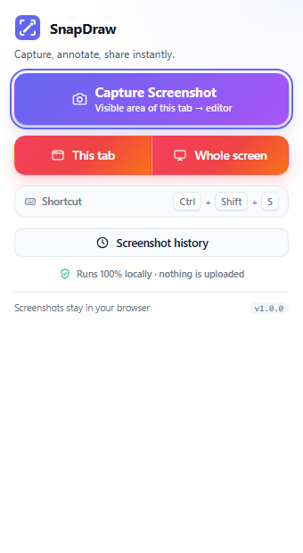
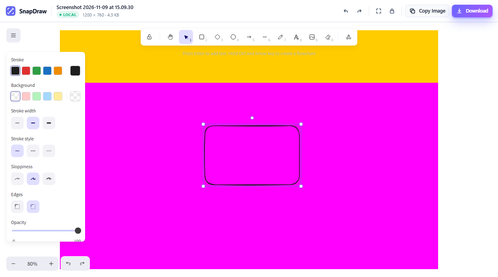
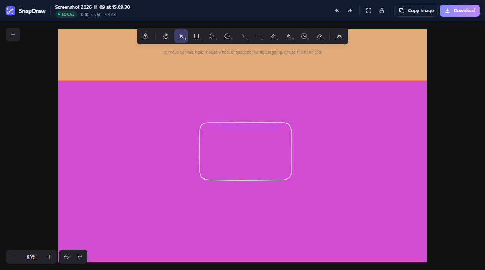
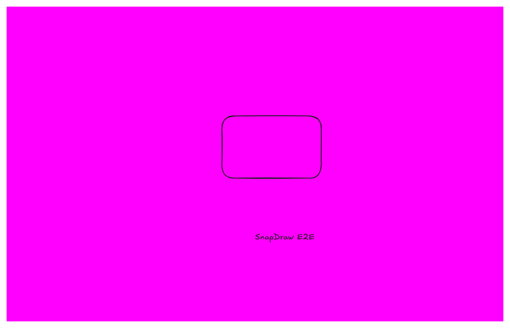
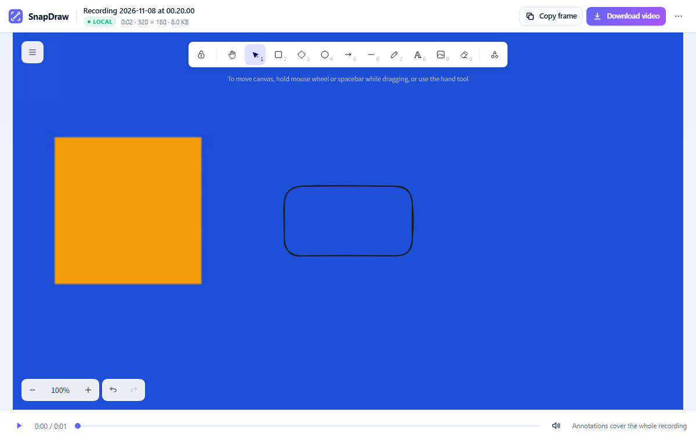
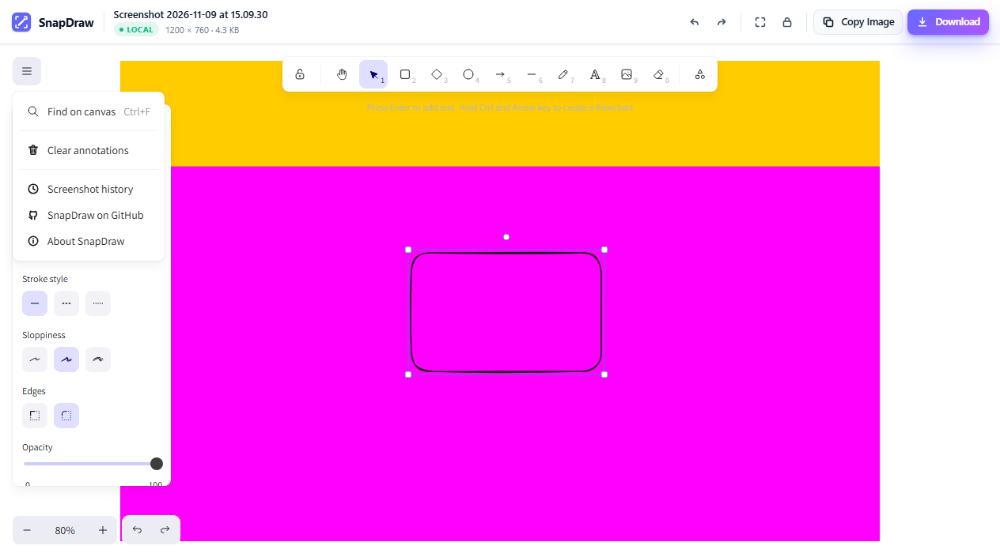
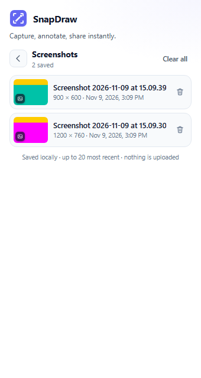
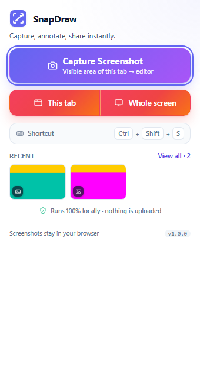
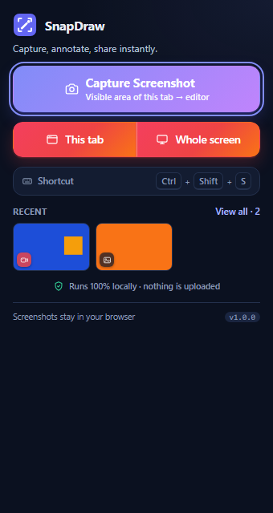

# SnapDraw

**Capture your screen → annotate it with Excalidraw → copy or download. Now with tab video recording.**

SnapDraw is a lightweight Chrome extension (Manifest V3) that turns the visible browser viewport
into an editable Excalidraw canvas in a single click — and can **record the current tab**, then
annotate the video with the same Excalidraw toolset. No account, no upload, no backend: captures,
recordings, annotations and every asset live on your machine.

| Popup | Editor (light) |
| --- | --- |
|  |  |

| Editor (dark) | Capture result |
| --- | --- |
|  |  |

*Screenshots and the exported PNG above are produced automatically by the end-to-end test suite.*



*The video editor plays the recording with a transparent Excalidraw layer on top; annotations are
baked into the exported WebM (or copied as a still frame).*



*The SnapDraw menu replaces Excalidraw's default menu – its only links point back to this project.*



*Screenshot history: captures are saved locally with a thumbnail and can be reopened, deleted or
cleared. Refreshing an editor tab keeps its screenshot.*



*The capture view also shows a compact preview of the most recent captures — click a thumbnail to
reopen it, or **View all** for the full history. Recordings appear here too, with a video icon.*



*Recordings are marked with a video-camera icon (screenshots get an image icon), so mixed histories
stay readable at a glance.*

---

## Table of contents

- [Features](#features)
- [How it works](#how-it-works)
- [Quick start](#quick-start)
- [Using SnapDraw](#using-snapdraw)
- [Scripts](#scripts)
- [Project structure](#project-structure)
- [Architecture](#architecture)
- [Local-only guarantees](#local-only-guarantees)
- [Permissions](#permissions)
- [Testing](#testing)
- [Troubleshooting](#troubleshooting)
- [Extending SnapDraw (Version 2)](#extending-snapdraw-version-2)
- [Tech stack & credits](#tech-stack--credits)
- [License](#license)

---

## Features

- **One click to capture** – the popup is a single primary action; the visible viewport is captured
  with `chrome.tabs.captureVisibleTab()` in PNG at its native resolution.
- **Editor opens automatically** – a new tab loads the screenshot straight into an Excalidraw canvas.
- **Full Excalidraw toolset** – freehand, arrows, lines, rectangles, diamonds, ellipses, text, colors,
  stroke styles/widths, fill, opacity, layers, zoom/pan, select/move/resize, undo/redo.
- **Screenshot is protected** – inserted as a **locked** image element at its original pixel size, so
  it cannot be moved or deleted by accident. The lock toggle sits in the header next to **Reset view**.
- **Header actions where you expect them** – undo/redo, reset view and the screenshot lock are grouped
  together; Copy Image and Download sit on the right. No duplicate or dead buttons.
- **SnapDraw menu** – replaces Excalidraw's menu: *Find on canvas*, *Clear annotations*,
  *SnapDraw on GitHub* and *About SnapDraw*. Excalidraw's help dialog, social links and the
  `libraries.excalidraw.com` panel are removed, so the only outbound links are SnapDraw's own.
- **Copy to clipboard** – exports the annotated PNG and writes it to the clipboard (Slack, Discord,
  mail, docs…), with a confirmation toast and graceful error handling.
- **Download PNG** – full-quality 1:1 export (screenshot + annotations + breathing-room padding).
- **Record in the background** – two split buttons in one line record either **This tab** or the
  **Whole screen**. No recorder tab is opened: an offscreen document owns the `MediaRecorder`, so
  recording keeps running after the popup closes. Click the SnapDraw icon again to see the live timer,
  then **Stop and open editor** (or **Cancel recording**). The toolbar shows a red **REC** badge while
  a recording is active.
- **Annotate videos with the same Excalidraw tools** – the video editor plays the recording with a
  fully transparent Excalidraw layer positioned exactly over the video, so every drawing tool works.
  Annotations cover the whole clip. **Copy frame** puts the annotated current frame on the clipboard,
  **Download video** renders the annotated WebM, and the header can also download the original.
- **Multi-capture safe** – every capture/recording gets a UUID session; several editor tabs never mix data.
- **Saved history + refresh-safe editor** – captures and recordings are kept in local IndexedDB, so
  reloading an editor tab keeps the media, and the popup's **Screenshot history** lists everything
  (images and videos, newest first, with thumbnails + duration) to reopen, delete or clear. The capture
  view also shows a compact **recent-captures preview** (up to three thumbnails, click to reopen) with
  a **View all** link; each thumbnail carries an image or video type icon so you can tell them apart at
  a glance. Old captures saved without a thumbnail are healed automatically.
  Up to 20 captures/recordings are kept for 30 days.
- **Light & dark** – follows the OS colour scheme; the exported PNG is always light/white.
- **Friendly failures** – restricted pages (`chrome://`, Web Store, other extensions, DevTools) get
  an explanation and a retry path instead of a cryptic Chrome error.
- **Keyboard shortcut** – `Ctrl+Shift+S` (`⌘+Shift+S` on macOS), configurable in Chrome.
- **100% local** – no requests, no analytics, no fonts from a CDN. Everything is bundled.

## How it works

```text
  toolbar click / shortcut
          │
          ▼
 ┌────────────────────┐   runtime message    ┌─────────────────────────┐
 │  Popup (React)     │ ───────────────────▶ │  Background service     │
 │  Capture button    │                      │  worker (MV3)           │
 └────────────────────┘                      │  · active tab + URL     │
                                             │  · captureVisibleTab    │
                                             │  · data URL → Blob      │
                                             │  · IndexedDB session    │
                                             └───────────┬─────────────┘
                                                         │ chrome.tabs.create(
                                                         │   editor.html?session=<uuid>)
                                                         ▼
                                             ┌─────────────────────────┐
                                             │  Editor tab (React)     │
                                             │  · read Blob → data URL │
                                             │  · record stays saved   │
                                             │  · Excalidraw initialData│
                                             │  · copy / download PNG  │
                                             └─────────────────────────┘
```

The screenshot never travels through URL query strings or cross-tab in-memory variables: the service
worker writes a `Blob` (plus a small thumbnail) into IndexedDB and the editor reads it from the same
extension origin. Nothing is deleted on load, so **refreshing the editor keeps the screenshot** and
the same capture can be reopened later from the popup's history. A retention sweep (30 days / newest
20 captures) keeps the local history bounded.

### Video recording

```text
  popup split action (user gesture, no new tab)
    ├─ "This tab"     → chrome.tabCapture.getMediaStreamId()
    └─ "Whole screen" → chrome.desktopCapture.chooseDesktopMedia(["screen","window"])
          │  streamId
          ▼
  service worker ──▶ offscreen document (src/offscreen/offscreen.html)
          │            │ getUserMedia({chromeMediaSource: tab | desktop})
          │            │ MediaRecorder(WebM + tab audio when available)
          │            │ live timer state · toolbar "REC" badge
          │            ▼
          │         saveRecording() ──▶ IndexedDB (kind: "video", duration, thumbnail)
          │            │
          │            ▼
          │         video.html?session=<uuid>   (opened by the worker)
          │
          └─ popup reopened while recording → GET_STATUS → Stop & edit / Cancel

  video editor: <video> + transparent Excalidraw overlay (object-fit: contain rect)
  Copy frame (PNG) · Download annotated video (WebM) · Download original
```

The popup only hands a short-lived stream id to the service worker; the actual `MediaRecorder` lives
in a hidden offscreen document, so **no recorder tab is opened and the popup can close**. Starting a
recording requires the toolbar-icon gesture (that is what grants `activeTab`/`tabCapture` for the tab).
Chrome-protected pages (`chrome://`, the Web Store, DevTools) are rejected with a friendly message
before recording starts, and a failed start cleans up the offscreen document again.

## Quick start

### Prerequisites

- **Node.js 22.12+** (Vite 8 requirement) and npm 10+
- **Google Chrome 116+** (Manifest V3 minimum); Chrome 137+ or Chromium if you want to run the E2E suite

### Build & install

```bash
git clone <your-fork-url> snapdraw
cd snapdraw
npm install
npm run build          # typecheck + vite build + build validation → dist/
```

Then:

1. Open `chrome://extensions`.
2. Enable **Developer mode** (top right).
3. Click **Load unpacked** and select the generated **`dist/`** folder.
4. Pin SnapDraw to the toolbar (puzzle-piece menu → pin).

### Development

```bash
npm run dev     # vite build --watch --mode development (unminified, source maps)
```

Because Chrome extension pages cannot use a dev server with remote/HMR scripts, `npm run dev`
rebuilds `dist/` on change. After a rebuild, click the **reload** icon for SnapDraw on
`chrome://extensions` (or press `Ctrl+R` on that page) and reopen the popup/editor tab.

`npm run preview` starts a plain Vite dev server for UI work: the popup renders in "preview mode"
and the editor shows its error state, since `chrome.*` APIs are unavailable outside the extension.

## Using SnapDraw

1. Open any normal website.
2. Click the SnapDraw icon → **Capture Screenshot** (or press `Ctrl+Shift+S` / `⌘+Shift+S`).
3. The editor tab opens with the screenshot centred and ready to annotate.
4. Annotate with the Excalidraw toolbar on top.
5. **Copy Image** and paste anywhere, or **Download** to save `<document-name>.png`.
6. The **SnapDraw menu** (top-left) has *Find on canvas*, *Clear annotations*, *Screenshot history*,
   *SnapDraw on GitHub* and *About SnapDraw*. **Reset view** and the **screenshot lock** live in the
   header next to undo/redo; **Copy Image** and **Download** are on the right.
7. Reopen the popup to see the **saved history**: the capture view shows a compact **Recent** strip
   (click a thumbnail to reopen that capture), and **View all · N** opens the full history (reopen,
   delete one, or **Clear all**). Refreshing an editor tab keeps its media, and captures survive
   browser restarts until they age out of the history (30 days / 20 newest).

### Recording a video

1. Open the page you want to record and click the SnapDraw icon.
2. Use the split record control: **This tab** records only the current tab; **Whole screen** asks
   Chrome which screen/window to share, then records all of it (including browser tabs and apps).
   Recording starts immediately — **no recorder tab is opened**.
3. The popup closes; the toolbar shows a red **REC** badge. Switch tabs, scroll, demo the app — the
   recording continues in the background.
4. Click the SnapDraw icon again to reopen the popup: it shows the live timer with **Stop and open
   editor** and **Cancel recording**.
5. **Stop and open editor** saves the WebM locally and opens the **video editor** tab.
6. Annotate over the video with the Excalidraw tools (the layer is transparent and exactly covers the
   video). Use the transport bar to play/seek/mute; **Copy frame** copies the annotated current frame,
   **Download video** renders the annotated WebM (real time), and **More → Download original** saves
   the un-annotated recording.
7. Recordings appear in the same history as screenshots, marked with a video camera icon and their
   duration; screenshots carry an image icon.

The pointer is the selection tool. Keyboard shortcuts from Excalidraw apply (`1`–`8` / `r`, `o`,
`a`, `t`, `l`, `p`, `d`, `z` for tools; `Ctrl/⌘+Z`, `Shift+Ctrl/⌘+Z` for undo/redo; space-drag to pan).

Change the capture shortcut at `chrome://extensions/shortcuts` (SnapDraw → *Capture the visible
screen…*). The popup always shows the shortcut that is actually registered. The keyboard shortcut
captures a screenshot; video recording is started from the popup (Chrome needs the icon-click gesture
for `tabCapture`/`desktopCapture`).

## Scripts

| Script | What it does |
| --- | --- |
| `npm run build` | Copies Excalidraw's fonts into `public/fonts`, typechecks, builds the extension into `dist/`, validates the output. |
| `npm run build:only` | Same as `build` without the TypeScript check (faster iteration). |
| `npm run dev` | Watch-mode development build. |
| `npm run typecheck` | `tsc --noEmit` across the whole project. |
| `npm test` | Vitest unit + invariant suite (175 tests: storage/history, image & video helpers, recording service, messaging, manifest, capture/export services). |
| `npm run test:e2e` | Drives the **built** extension in headless Chrome via CDP: capture → editor → annotate → undo/redo → clipboard → download → history/preview → video editor + annotated WebM export → multi-capture isolation → restricted-page errors → local-only audit. Writes `test-results/e2e-report.json` and `docs/screenshots/*.png`. |
| `npm run verify` | `build` + `test` + `test:e2e`. |
| `npm run icons` | Regenerates `public/icons/icon{16,48,128}.png` from the logo geometry (no image dependency). |
| `npm run clean` | Removes `dist/`. |

## Project structure

```text
snapdraw/
├── public/
│   ├── manifest.json               # MV3 manifest (stable "key", strict CSP)
│   ├── icons/                      # icon16/48/128.png (generated)
│   ├── excalidraw-asset-path.js    # classic script: local font base + CDN fallback rewrite
│   └── fonts/                      # Excalidraw fonts, copied at build time (gitignored)
├── src/
│   ├── background/service-worker.ts
│   ├── popup/                      # Popup.tsx, popup.css, useCapture.ts, shortcut.ts, components/
│   ├── editor/                     # Editor.tsx, EditorCanvas.tsx, EditorHeader.tsx, AboutDialog.tsx,
│   │                               # excalidrawActions.ts, links.ts, editor.css
│   ├── offscreen/                  # offscreen.html + offscreen.ts (background MediaRecorder)
│   ├── video/                      # VideoEditor.tsx, VideoStage.tsx, VideoHeader.tsx, TransportBar.tsx
│   ├── components/                 # Button, Toast, Logo (shared primitives)
│   ├── services/                   # screenshot, image, storage, thumbnail, recording, video,
│   │                               # video-export, export, clipboard
│   ├── utils/                      # messaging, image-conversion
│   ├── types/                      # shared contracts + Excalidraw export type shim
│   └── styles/global.css           # design tokens + shared component styles
├── tests/                          # Vitest suites
├── scripts/                        # build/validation/E2E/icon pipelines
├── docs/screenshots/               # generated screenshots used in this README
├── vite.config.ts                  # multi-entry MV3 build (popup, editor, video, recorder, worker)
├── tsconfig.json
└── package.json
```

## Architecture

### Extension components

| Component | Responsibility |
| --- | --- |
| **Popup** (`src/popup/`) | Renders the capture action, live shortcut hint, local-only trust copy, inline error states, a compact **Recent** thumbnail preview and the full **Screenshot history** view (reopen, delete, clear). Sends `{ type: "CAPTURE_SCREENSHOT" }` to the service worker. |
| **Service worker** (`src/background/`) | Resolves the active tab, rejects restricted pages, captures the viewport, stores the screenshot + thumbnail, opens the editor tab, and handles the keyboard command. When a keyboard capture fails there is no popup to show the error, so the worker flags the toolbar icon (`!` badge + tooltip) and opens a short explanation tab. |
| **Screenshot service** (`src/services/screenshot.service.ts`) | The capture pipeline itself (including thumbnail generation and history pruning); pure helpers (`classifyTabUrl`, `buildScreenshotName`, `toErrorPayload`) are unit-tested. |
| **Editor** (`src/editor/`) | Loads the capture from IndexedDB, builds the Excalidraw scene, provides header actions (undo/redo, reset view, lock, copy, download), a SnapDraw-branded menu and loading/error screens. Refresh-safe: the stored capture is not deleted. |
| **Excalidraw integration** (`src/editor/EditorCanvas.tsx`, `excalidrawActions.ts`) | One locked image element at natural pixel size + `files` map, `fitToContent` on mount, scene updates for lock/clear, PNG export helpers. |
| **Recorder orchestration** (`src/background/service-worker.ts` + `src/offscreen/`) | The popup sends a `tabCapture`/`desktopCapture` stream id to the worker; the worker creates a hidden offscreen document that owns the `MediaRecorder` (WebM + tab audio), keeps the **REC** badge in sync, answers status/stop requests, saves the recording to IndexedDB and opens the video editor. |
| **Video editor** (`src/video/`) | Loads the recording, renders `<video>` with a transparent Excalidraw overlay on the exact video rect, transport controls, Copy frame / Download annotated video / Download original, progress + cancel. |
| **Video services** (`src/services/recording.service.ts`, `video.service.ts`, `video-export.service.ts`) | Stream-id handover + recording persistence, video metadata/thumbnail/duration helpers, and real-time annotated-WebM export (`canvas.captureStream` + `MediaRecorder`, tab audio mixed via `AudioContext`). |
| **Services** (`src/services/`) | `storage` (IndexedDB history, thumbnails, pruning), `image` (decode/encode), `export` (PNG blob + download), `clipboard`. |

### Image transfer, persistence and history

- Database: **IndexedDB `snapdraw`**, object store `screenshots` (keyPath `id`, index on `createdAt`).
- The service worker stores the PNG as a real `Blob` (`getImageDimensions` uses `createImageBitmap`)
  plus a ≤320px PNG thumbnail for the history list.
- The editor tab is opened at `src/editor/editor.html?session=<uuid>`; it loads the record and converts
  it to a data URL for Excalidraw's `BinaryFiles`. **The record is kept**, so refreshing the editor
  reloads the same capture instead of erroring.
- History replaces the old "delete after load" model: the popup lists captures newest first and can
  reopen, delete or clear them. Thumbnails are generated at capture time (`thumbnail.service.ts`);
  records that predate thumbnails get one generated on demand and persisted. Retention is bounded to
  the newest **20 captures** and **30 days** (`HISTORY_LIMIT` / `HISTORY_RETENTION_MS` in
  `storage.service.ts`), pruned on startup and after captures.

### Video recording, persistence and export

- Records use the same IndexedDB store, tagged `kind: "video"`, with `durationMs` and a WebM
  thumbnail. History/preview show a video-camera icon (images get an image icon) and the duration, and
  open the video editor instead of the image editor (`kind` routing in
  `src/popup/openScreenshot.ts`).
- **Recording (background, no extra tab):** the popup calls `chrome.tabCapture.getMediaStreamId()` for
  **This tab** or `chrome.desktopCapture.chooseDesktopMedia(["screen","window"])` for **Whole screen**
  while it still owns the user gesture. It sends the stream id to the service worker, which creates a
  hidden offscreen document (`src/offscreen/`) that consumes it with `getUserMedia` and records with
  `MediaRecorder` (`video/webm;codecs=vp8|vp9,opus`). Tab audio is captured when available and falls
  back to video-only; whole-screen recording is video-only. The worker reflects the state in a red
  **REC** badge and answers `RECORDING_STATUS` / `RECORDING_STOP` when the popup is reopened. If the
  source ends on its own (tab closed, screen share stopped) the offscreen document saves the recording
  and asks the worker to open the editor.
- **Editing:** `src/video/video.html?session=<id>` renders the video with a transparent Excalidraw
  canvas positioned over the `object-fit: contain` video rectangle — annotations map 1:1 onto the
  recording. Annotations cover the whole clip (per-timestamp annotations are a v2 item).
- **Export:** `exportAnnotatedVideo()` replays the video in real time, draws each frame + the
  Excalidraw static canvas into a `<canvas>` at the recording's native resolution, captures that canvas
  at 30 fps together with the original audio (`AudioContext` → `MediaStreamAudioDestinationNode`, not
  routed to the speakers), and records the result with `MediaRecorder` to a local WebM. Progress and
  Cancel are exposed in the UI. Because it is real-time, a 2-minute clip takes about 2 minutes to
  export.

### Excalidraw integration notes

- Package: `@excalidraw/excalidraw@0.18.1`, React 18.
- `window.EXCALIDRAW_ASSET_PATH` points at the extension's own `fonts/` folder. The classic
  `public/excalidraw-asset-path.js` script runs before the module bundle (Excalidraw reads the value
  at module init) and also rewrites Excalidraw's built-in CDN fallback URLs to local copies. The
  extension's CSP is the final backstop: no remote font can load even if that changes upstream.
- `UIOptions.canvasActions` disables Excalidraw's own export/load/save menus so SnapDraw's header is
  the only source of truth for those actions; the full drawing toolbar stays untouched.
- Excalidraw 0.18 exposes no imperative `undo()`/`redo()`, so the header buttons replay the editor's
  own `Ctrl/⌘+Z`/`Shift+Ctrl/⌘+Z` keyboard action on the Excalidraw container
  (`src/editor/excalidrawActions.ts`). Pressing the keys directly works too.
- **Branding is SnapDraw's:** the default Excalidraw main menu is replaced through the supported
  `MainMenu` API (`src/editor/Editor.tsx`), so its *Help / GitHub / Follow us / Discord* links are
  gone; SnapDraw's GitHub and About entries take their place. The help dialog entry point
  (`.help-icon`, including the `?` shortcut) and the library panel (`libraries.excalidraw.com`) are
  removed in `src/editor/editor.css` + `src/editor/Editor.tsx`, and the About dialog lives in
  `src/editor/AboutDialog.tsx`. The only outbound links are SnapDraw's repository and issue tracker.
- The screenshot element uses its natural pixel dimensions and is fitted to the viewport with
  `scrollToContent(..., { fitToContent: true })`, so the exported PNG is 1:1 with the capture.
- Export uses `exportToBlob` with `exportScale: 1`, `exportBackground: true`, white background and
  16px padding (imported in `src/services/export.service.ts`).

## Local-only guarantees

SnapDraw is designed so that no byte of your screen content can leave the machine:

- **No backend, no accounts, no analytics, no telemetry, no external requests in `src/`.**
- **Screenshots and recordings live only in IndexedDB** inside your Chrome profile — kept as a local
  history so editors can be refreshed and captures can be reopened later. At most 20 items (30 days)
  are kept; delete individual entries or clear everything from the popup's history. Uninstalling
  SnapDraw or clearing the extension's site data removes them.
- **Video stays local too:** tab recording uses Chrome's `tabCapture` stream, MediaRecorder stores the
  WebM in IndexedDB, and the annotated export is rendered in-page. No upload, no cloud, no ffmpeg
  service — the only output is the file you choose to download.
- **All Excalidraw fonts are bundled** (`npm run build` copies them from the installed package into
  `public/fonts`, ~12 MB). Nothing is fetched from `esm.sh` or any other CDN at runtime.
- **Strict Manifest V3 CSP** on every extension page:

  ```text
  default-src 'self'; script-src 'self'; style-src 'self' 'unsafe-inline';
  img-src 'self' data: blob:; font-src 'self' data:; connect-src 'self' data: blob:;
  media-src 'self' blob:; worker-src 'self'; object-src 'none'; base-uri 'self'; form-action 'none'
  ```

  Remote scripts, fonts, images, media and network connections are blocked by Chrome itself.
- The **only** files that ever leave the extension are a PNG/frame you copy or a PNG/WebM you download.
- `npm run build` fails validation if the manifest gains extra permissions, host permissions,
  content scripts, remote URLs in extension pages, or loses the local-only CSP directives
  (`scripts/validate-build.mjs`).

## Permissions

Only five permissions are requested, and there are **no host permissions**:

| Permission | Why it is needed |
| --- | --- |
| `activeTab` | Grants one-time access to the tab the user just clicked on. `chrome.tabs.captureVisibleTab()` requires it (or broad host permissions we deliberately avoid), and it lets the extension read the tab's URL/title to produce a friendly name and reject restricted pages. Granted by the toolbar popup click and by the keyboard command. |
| `tabCapture` | Records the current tab's video (and its audio when available) with `chrome.tabCapture.getMediaStreamId()` + `getUserMedia`. Only usable after the user invokes the extension (toolbar click), which is exactly how recording starts. |
| `desktopCapture` | Lets **Whole screen** ask Chrome's own picker for a screen/window stream (`chrome.desktopCapture.chooseDesktopMedia`). The stream is recorded locally; nothing is uploaded. |
| `offscreen` | Keeps the `MediaRecorder` alive in a hidden offscreen document after the popup closes, so recording runs in the background without opening a recorder tab. |
| `clipboardWrite` | Allows the editors to put an annotated PNG/frame on the clipboard. |

Persistence uses **IndexedDB**, so no `storage` permission is needed. Tabs are opened with
`chrome.tabs.create` (no permission required) and the editors do not need `scripting`.

Chrome refuses to capture a handful of protected pages. SnapDraw detects these up front and explains
the restriction instead of failing with a raw Chrome error: `chrome://` / `chrome-untrusted://` /
`edge://` / `about:` / `view-source:` pages, the Chrome Web Store, DevTools, and other extensions'
pages.

## Testing

### Unit & invariant tests (`npm test`)

175 tests across eight suites, no network and no real Chrome:

- `tests/storage.test.ts` – IndexedDB round-trips (multi-MB `Blob` byte-exact), isolation of three
  concurrent sessions, history listing + thumbnails, retention/TTL purge, history trimming and
  clearing.
- `tests/image-conversion.test.ts` – data-URL ↔ Blob conversion, `fitWithin`, `formatBytes`,
  dimension-decoding failure path.
- `tests/messaging.test.ts` – message contracts, URL/session/recorder parsing, `requestCapture` error
  normalisation, service-worker listener behaviour (including synchronous throws).
- `tests/manifest.test.ts` – MV3 shape, exact permission set (including `tabCapture`/`desktopCapture`/
  `offscreen`), no host permissions/content scripts, local-only CSP, icon files, command binding,
  offscreen/video entries.
- `tests/screenshot.service.test.ts` – URL classification (22 cases), naming, Chrome error mapping,
  every capture failure path plus the full success path against mocked `chrome` + fake-indexeddb.
- `tests/export.service.test.ts` – filename sanitising, pre-flight size guards, error mapping,
  download guard.
- `tests/video.service.test.ts` – duration formatting, video filename sanitising, `kind`/mime
  detection, MediaRecorder mime selection, missing-recording errors.
- `tests/recording.service.test.ts` – recording naming, `tabCapture` stream-id handover + error mapping,
  and persisting a finished WebM as a `kind: "video"` history record with duration.

### End-to-end tests (`npm run test:e2e`)

The E2E harness launches real headless Chrome, installs the **built** extension via the DevTools
`Extensions` domain, and drives the actual UX. It requires **Chrome 137+** (branded Chrome ignores
`--load-extension` since 137; the harness uses the CDP extension API instead) or Chromium/Chrome for
Testing. Pass `--chrome="<path>"` if autodetection fails; use `--headed --keep` to watch a run and
keep its temp profile.

It verifies (112 checks, all driven through real input events and real downloads):

- extension + service worker load with a stable ID (manifest `key`);
- popup renders the capture action, record-video action, shortcut hint, local-only copy, version,
  dash-free tagline and the history entry point; the capture and record actions share one size/shape
  and use distinct colours (primary gradient vs. warm record gradient);
- one click captures a 1200×760 viewport, opens the editor tab with that session, and loads the
  screenshot into Excalidraw at exactly 1232×792 (native size + 16px padding);
- the capture is **saved** (not deleted), and reloading the editor tab restores the screenshot with no
  error screen;
- a locked screenshot survives an accidental `Delete`;
- the header contains exactly *Undo, Redo, Reset view, Lock, Copy Image, Download* (no Share) and
  reset view + lock sit next to undo/redo;
- the SnapDraw menu opens with GitHub / About SnapDraw links, no Excalidraw or social links; the
  About dialog opens, states the local-only promise and links to the repository; Excalidraw's help
  button, library button and `?` help dialog are unreachable;
- drawing a rectangle + adding text renders both into the exported PNG; the handwriting font is
  loaded locally and **zero external resources** are requested;
- header undo returns to the untouched screenshot and redo restores the annotations;
- copy writes a real `image/png` to the clipboard (with a success toast);
- a second capture (900×600) opens its own tab, shows only its own screenshot, and leaves the first
  editor intact;
- the popup's **Screenshot history** lists both captures newest-first with rendered thumbnails, reopens
  the selected capture in the editor, deletes one entry, and clears the rest (emptying IndexedDB);
- the capture view's **recent-captures preview** shows the saved thumbnails (verified to contain the
  actual page content, not a blank block), links to the full history and opens the newest capture
  when clicked; a legacy capture without a thumbnail gets one generated and persisted automatically;
- the popup exposes **This tab** and **Whole screen** recording actions; `tabCapture` and
  `desktopCapture` are available;
- the popup capture button carries its own explanation inside, and the two split recording buttons
  sit on one line with distinct recording colours;
- the **video editor** loads a real WebM, mounts the transparent Excalidraw overlay over the video,
  accepts a drawn annotation, copies the annotated frame to the clipboard, and **exports a valid
  annotated WebM** (EBML header checked) from a real-time render;
- history and the recent preview mark recordings with a **video camera icon** and screenshots with an
  **image icon**, show durations, and reopen the recording in the video editor;
- the service worker reports idle/recording state, and the recording pipeline is exercised downstream
  with a real WebM (headless Chrome cannot create tab/screen capture streams, so the actual
  start-recording gesture is a manual check — see *Recording a video* above);
- extension pages produce the friendly restricted-page error with retry; missing/expired sessions and
  `?error=` messages show recoverable error screens;
- light + dark editor screenshots (and the video editor screenshot) are written to `docs/screenshots/`.

Artifacts: `test-results/e2e-report.json`, `test-results/export-*.png`, `docs/screenshots/*.png`.

> The harness copies `dist/` to a temp folder and adds `host_permissions: ["<all_urls>"]` + `tabs` to
> **that copy only**, because there is no real toolbar click to grant `activeTab` in automation. The
> shipped manifest keeps its minimal permission set (and validation enforces it).

## Troubleshooting

**"Chrome doesn't allow capturing this page."**
Chrome protects internal pages. Switch to a normal `http(s)` website and capture again. The same
applies to the Chrome Web Store even though it is a normal URL.

**The keyboard shortcut does nothing.**
Another extension may own `Ctrl+Shift+S`. Assign a free combination at `chrome://extensions/shortcuts`
(SnapDraw → *Capture the visible screen…*). The popup shows the shortcut Chrome actually registered. If
the shortcut fires but capture is impossible (e.g. a `chrome://` tab is focused), SnapDraw flags the
toolbar icon with a red `!` and opens a tab explaining the restriction.

**Nothing happens / the editor says "Screenshot not found".**
That only happens if the editor URL has no `session` parameter, the capture was deleted from the
popup's history, or it aged out of the local history (30 days / older than the 20 newest). Capture
again, or open a saved capture from **Screenshot history** in the popup.

**The screenshot disappeared after refreshing the editor.**
It shouldn't — captures are persisted in IndexedDB. Make sure you are on the latest build and that
Chrome allows the extension to store site data (extension pages use `chrome-extension://` origin
storage). Rebuild + reload the extension if you upgraded from the earlier "delete after load" build.

**"SnapDraw couldn't start recording this tab."**
Recording only works on normal `http(s)` pages, and must be started from the popup (Chrome requires the
toolbar-click gesture for `tabCapture`). `chrome://` pages, the Web Store, and DevTools cannot be
recorded. If **Whole screen** is used, Chrome's own picker must be answered — cancelling it shows an
error without starting anything. The extension console (`chrome://extensions` → SnapDraw →
*Service worker* / *Inspect views*) logs the underlying reason.

**The red REC badge stays on — how do I stop?**
Click the SnapDraw icon: the popup shows the live timer with **Stop and open editor** and **Cancel
recording**. Recording continues while the popup is closed, and the badge clears when the recording is
saved or cancelled. Closing the whole browser discards an in-progress recording (nothing is uploaded
or left running).

**The annotated video export takes as long as the recording.**
That's expected: the editor replays the clip and re-records the canvas in real time (this keeps the
tab audio in sync). Keep the editor tab in the foreground while it renders; a background tab gets
throttled by Chrome. **Cancel** is always available, and your annotations are kept if you cancel.

**The exported WebM doesn't play in some app.**
SnapDraw records WebM (VP8/VP9 video + Opus audio), which Chrome, Edge and Firefox play natively.
Safari/QuickTime and some editors need an MP4 conversion; do that locally with your preferred tool.
The original recording is always downloadable un-annotated from **More → Download original**.

**No audio in the recording.**
**This tab** captures the tab's audio, not the microphone or system audio. A muted tab, or a page that
wasn't playing sound, records silently; audio capture falls back to video-only when the tab has no
audio track. **Whole screen** is intentionally video-only.

**Copy Image says the clipboard is unavailable.**
Clipboard writes need a focused window and a user gesture, and some managed Chrome profiles block
them. Use **Download** instead. Reloading the extension after an update also resets clipboard grants.

**Screenshots of very large displays fail.**
Captures above 8192 px per side are rejected with a friendly error (Chrome's canvas limits). Capture a
smaller window (e.g. don't span multiple 4K monitors).

**Build fails with `spawn EPERM` / `net use` on Windows.**
That is Vite's Windows config-file real-path probe being blocked by a restrictive sandbox. Run the
build outside the sandbox, or use the native config loader:
`npx vite build --configLoader native`.

**Fonts look like a system fallback.**
Run `npm run build` (it copies Excalidraw's fonts into `public/fonts`, which is gitignored) and
reload the extension. Check `chrome://extensions` errors if a font file is missing.

**After `git clone`, the extension stops remembering my shortcut.**
The stable extension ID comes from the `key` field in `public/manifest.json`. Remove or replace that
field to get a fresh ID (Chrome derives one from the unpacked path); shortcuts, clipboard grants and
IndexedDB are tied to the ID.

**Chrome won't load `dist/`.** Make sure you selected the `dist` folder itself (the one containing
`manifest.json`), and that `npm run build` completed its validation step.

## Extending SnapDraw (Version 2)

The code is split so the roadmap can be added without reworking version 1:

- **Sharing (links, Slack, Discord, email, cloud).** Deliberately not part of v1 – SnapDraw is
  local-only and its header/menu carry no share action. When adding sharing, introduce an opt-in
  provider layer (typed `ShareProvider` interface + registry), surface it in the SnapDraw menu and
  require explicit `host_permissions`; nothing should leave the device until a provider is enabled.
- **Saved projects / annotated-scene persistence.** The history stores the original capture/recording
  (so editors survive refreshes and can be reopened); annotations are not persisted yet. Add a
  `projects` store in a version-2 IndexedDB upgrade and serialise the Excalidraw scene
  (`serializeAsJSON` + `files`) alongside the capture, then hydrate `EditorCanvas.tsx` / `VideoStage`
  from it. A scene timeline (`[{ atMs, elements }]`) would also unlock per-timestamp video annotations.
- **Configurable history.** Retention is currently fixed (`HISTORY_LIMIT` 20 / `HISTORY_RETENTION_MS`
  30 days) in `storage.service.ts`; surface those as settings and add thumbnails to a dedicated
  full-page history view if the popup ever feels small.
- **Video editing depth.** Timestamped/keyframed annotations synced to playback, trimming/clipping,
  camera + microphone tracks, PiP overlays, and faster-than-realtime export via WebCodecs (and MP4
  output). The recorder page and `exportAnnotatedVideo()` are the extension points.
- **Full-page capture.** `captureVisibleViewport()` in `screenshot.service.ts` is the single entry
  point; implement scrolling + `captureVisibleTab` stitching (or `chrome.debugger` /
  `captureBeyondViewport`) behind the same `CaptureResponse` contract. The editor accepts any
  dimensions up to 8192 px per side.
- **Custom naming / multiple sessions.** The document name comes from `buildScreenshotName()` and is
  editable in the header in a future iteration; session IDs are already per-capture UUIDs.
- **More shortcuts.** Add commands to `public/manifest.json` and handle them in
  `background/service-worker.ts` next to `capture-screenshot` (recording needs the popup gesture for
  `tabCapture`, so a shortcut can only open the popup).

Keep the validation rules in `scripts/validate-build.mjs` in mind: new permissions or remote URLs must
be intentional and documented.

## Tech stack & credits

- [Excalidraw](https://github.com/excalidraw/excalidraw) (`@excalidraw/excalidraw@0.18.1`, MIT) – the
  entire drawing engine, UI and export pipeline. SnapDraw embeds the package; it does not fork the app.
- React 18 + TypeScript 5 (strict) + Vite 8 (Rolldown) + Manifest V3.
- Video: `chrome.tabCapture` + `MediaRecorder` (WebM/VP8-9 + Opus) for recording, and
  `canvas.captureStream` + `MediaRecorder` + `AudioContext` / `MediaStreamAudioDestinationNode` for the
  annotated export — no ffmpeg or server-side processing.
- Vitest + fake-indexeddb for tests; a dependency-free PNG decoder in the E2E harness.
- Logo and icons are drawn in code (`src/components/Logo.tsx`, `scripts/generate-icons.mjs`) and
  generated as real PNGs — no binary design assets from third parties.
- Excalidraw's bundled fonts are redistributed under their respective licenses as part of the
  `@excalidraw/excalidraw` package (see `node_modules/@excalidraw/excalidraw` in the build).

## License

MIT — see [LICENSE](LICENSE). SnapDraw is an independent project and is not affiliated with
Excalidraw.
